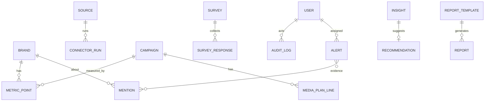

# Data Model
Full schema: `prisma/schema.prisma`.

## Decisions
- **Brand is the pivot** (self + competitors). Share of voice and benchmarks are queries across brands, not separate tables.
- **Mention is the universal listening record** for social, news, forums, reviews — `channel` distinguishes; news adds `outlet/headline`.
- **MetricPoint is a long-format time series** for every aggregated number (followers, sessions, opens…). One table, one chart component.
- **WebEvent is raw tracker data**; sessions/conversions derived in `analytics/service.ts` and materialised nightly into MetricPoints.
- **sourceKind on every record** → provenance chips in UI.
- **Alerts reference evidence mention ids** so the crisis drawer shows the real posts.
- **Everything AI is cached** (AiArtifact) and every insight/recommendation is materialised.
## Seed sizes
3 brands (Infratel + 3 fictional competitors = 4 brands) · 8 sources · 25k mentions over 120 days · 60 topics · 15k metric points · 20k web events · 6 campaigns · 24 media plan lines · 3 surveys · 450 responses · 12 alerts (historic) · 40 insights · 10 recommendations · 2 report templates · 4 reports.
